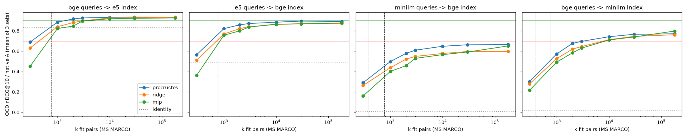

# embmigrate

**Can you switch text-embedding models without re-embedding your corpus?**

Every embedding model has its own vector space. Swap models and your index stops working until you re-embed everything. This project tests a shortcut: learn a map, ideally a pure rotation, from the new model's space into the old one using a few thousand paired documents, then measure how much retrieval quality survives. It also tests the flip side: does the same trick let an attacker read leaked vectors?

## TL;DR

- **Migration works, but never for free.** The best map keeps **~90%** of search quality between related models and **65–80%** between dissimilar ones. In every case, simply using either model on its own scored higher.
- **A rotation is the right map.** Orthogonal Procrustes matched or beat ridge regression and an MLP almost everywhere, and clearly won when few pairs were available. About 3–10k pairs is enough.
- **Shared initialization is a hidden confound.** bge and e5 are both fine-tuned from BERT-base. Searching an e5 index with bge queries, *no map at all*, already gets 83% of native quality.
- **Translated vectors leak topics, not text.** Mapping leaked vectors into a model with a public inverter (vec2text) reveals what documents are about, even with a fine-tuned inverter. It doesn't recover their wording.
- **Re-embedding is cheap** (about $100 per 10M documents via API), so migration only makes sense when re-embedding is impossible.

## How it works

1. Embed the same passages with model **A** (the existing index) and model **B** (the new query model).
2. Fit a map B → A on *k* pairs: orthogonal Procrustes (one SVD, closed form), ridge regression or a small MLP. For different dimensions, Procrustes gives a semi-orthogonal map.
3. Embed queries with B, map them into A's space, and search A's native index.
4. Score nDCG@10 against BEIR relevance judgments, as a fraction of A searching its own index.

Maps are fit **only on public MS MARCO passages** and tested on corpora they never saw (SciFact, NFCorpus, FiQA). That matches the hardest real case: you kept the vectors but not the source text.

Models: [`BAAI/bge-base-en-v1.5`](https://huggingface.co/BAAI/bge-base-en-v1.5), [`intfloat/e5-base-v2`](https://huggingface.co/intfloat/e5-base-v2), [`sentence-transformers/all-MiniLM-L6-v2`](https://huggingface.co/sentence-transformers/all-MiniLM-L6-v2). The native baselines reproduce published BEIR scores (e.g. bge: SciFact 0.740, NFCorpus 0.373, FiQA 0.406), which checks the pipeline.

## Results

### Migration quality

Fraction of native nDCG@10, averaged over SciFact, NFCorpus and FiQA:

| New queries → existing index | Dims | No map | Best map, 10k public pairs | Best map, 180k public pairs | 2k of the target corpus's own docs |
|---|---|---|---|---|---|
| bge → e5 | 768 → 768 | 0.83 | **0.93** (Procrustes) | 0.93 (Procrustes ≈ ridge) | 0.94 |
| e5 → bge | 768 → 768 | 0.49 | 0.88 (Procrustes) | 0.89 (Procrustes) | 0.92 |
| MiniLM → bge | 384 → 768 | 0.01 | 0.65 (Procrustes) | 0.67 (Procrustes) | 0.74 |
| bge → MiniLM | 768 → 384 | 0.01 | 0.74 (Procrustes) | 0.80 (MLP) | 0.89 |

The last column fits on documents from the target corpus itself. In a real migration you own the corpus, so that's the realistic in-domain option. No queries are used for fitting.



*Out-of-domain quality as public fit pairs grow. The dashed lines mark k = embedding dimension, below which Procrustes is underdetermined. Green = 90% of native, red = 70%.*

### Leak test

The threat model: an attacker has leaked vectors from model B, can query B, and has public text. They embed public text with B and [`gtr-t5-base`](https://huggingface.co/sentence-transformers/gtr-t5-base), fit a rotation, map the leaked vectors into gtr space, and run [vec2text](https://github.com/jxmorris12/vec2text)'s public gtr inverter. Texts are 32 tokens, matching the inverter.

| Inverted vectors | Token F1 vs original<br>(MS MARCO / FiQA) | Passages mostly recovered<br>(F1 ≥ 0.5) |
|---|---|---|
| Native gtr, 20 correction steps (upper bound) | 0.86 / 0.72 | 97% / 85% |
| bge / e5 / MiniLM → gtr, off-the-shelf inverter | 0.26–0.29 | 0–3% |
| bge → gtr, inverter **fine-tuned** on 52k mapped vectors\* | 0.30 / 0.32 | 10% / 7% |
| Raw bge, same fine-tune but no rotation (control)\* | 0.13 / 0.14 | 0% |
| Unrelated text (floor) | 0.08 / 0.11 | 0% |

\* One-shot decoding, with no correction steps. On the same one-shot setting, native gtr scores 0.54 / 0.49.

An example of what leaks:

> **Original:** We now have a large inventory of small and large yurts to rent for events, music festivals, retreats, weddings etc.
> **Reconstructed from mapped bge vector (fine-tuned):** We have rented thousands of yogi for weddings, weddings, and other special events…

The topic and structure survive, but the specifics don't. Mapped vectors reach only about 0.6 cosine to the true gtr vectors, which is too far for an inverter that expects exact inputs. Fine-tuning closes little of that gap. The rotation still helps the attacker: at the same training budget, it gets more than twice as far as learning the raw space from scratch.

## Findings

1. **Migration always costs quality.** No mapped setup beat either model used natively. For example, MiniLM queries mapped into a bge index score 0.67× bge, while plain MiniLM scores 0.88× bge.
2. **Constrained beats free.** Procrustes is best or tied across the k sweep. It is significantly better than ridge for MiniLM → bge at full k (+2.5 to +4.6 nDCG points, paired-bootstrap 95% CIs exclude 0), and it leads in every direction at k ≤ 3k.
3. **Sample efficiency.** Quality jumps once k exceeds the embedding dimension and saturates by about 10–30k pairs.
4. **Your own data beats public data.** 2k in-domain documents beat 180k MS MARCO pairs.
5. **Check for shared initialization.** Models fine-tuned from the same base share coordinates. Claims about "universal" embedding geometry should be tested on pairs with different base models.
6. **Leakage is topic-level at small budgets.** A cheap supervised attack (5k pairs, a closed-form map, a public inverter) reveals topics. Fine-tuning on 52k examples adds little.

### Does the "rotation" theory hold?

[Balestriero & LeCun (2026)](https://arxiv.org/abs/2610.39302) prove that JEPA models trained on "good views" learn the same representation up to a rotation. Production text embedders are contrastive bi-encoders, which is outside that theorem. Still, a rotation is the best *simple* description of how they relate, and it generalizes out of domain at least as well as unconstrained maps. But the match is far from exact (65–93% of native, not ~100%), and the best case is helped by shared initialization.

One hypothesis we set before running failed. Procrustes doesn't lose *less* than ridge or the MLP when moving out of domain: it gains the most from in-domain data. It still scores highest out of domain in absolute terms. Details are in [results/RESULTS.md](results/RESULTS.md).

### Economics

`text-embedding-3-small` costs $0.02 per million tokens: about $100 to re-embed 10M documents of 500 tokens, and about $1,000 for 100M. Self-hosted bge-base ran at about 112 short passages/s and about 43 long passages/s on one laptop (Apple M5 Max). A lossless re-embed at that price beats a 7–35% quality loss in almost every case. Migration only wins when re-embedding is **impossible** (the source text is gone), or as a temporary bridge while a new index builds. It fits better as a vector-database feature than as a standalone product.

## Prior work

- Conneau et al. 2018, [*Word Translation Without Parallel Data*](https://arxiv.org/abs/1710.04087): orthogonal Procrustes for aligning word embeddings across languages.
- Morris et al. 2023, [*Text Embeddings Reveal (Almost) As Much As Text*](https://arxiv.org/abs/2310.06816): vec2text, inverting embeddings back to text.
- Jha et al. 2025, [*Harnessing the Universal Geometry of Embeddings*](https://arxiv.org/abs/2505.12540): vec2vec, translating between embedding spaces without paired data.
- Balestriero & LeCun 2026, [*Proving and Improving the Platonic Representation Hypothesis with JEPAs*](https://arxiv.org/abs/2610.39302).

This project adds:
- k-pair learning curves for production text embedders.
- Constrained vs unconstrained maps compared out of domain, with significance tests.
- A migration benchmark against native baselines.
- A cheap supervised leak measurement with a fine-tuned attacker and a no-rotation control.

## Reproduce

Requires Python 3.11 and [uv](https://docs.astral.sh/uv/). Tested on an Apple Silicon Mac (MPS). Everything runs locally, with no API keys.

```bash
uv sync
uv run pytest -q tests                      # planted-rotation recovery, semi-orthogonality, ridge/MLP
uv run python scripts/01_embed_all.py       # downloads ~1.6 GB; ~2.5 h on MPS
uv run python scripts/02_ood.py             # migration experiment -> results/ood*.csv + plot
uv run python scripts/03_leak.py            # leak test -> results/leak*.csv
uv run python scripts/04_leak_finetune.py   # fine-tuned attacker -> results/leak_finetune*.csv; 1–4 h on MPS
```

| Path | What it does |
|---|---|
| `src/embmigrate/maps.py` | Procrustes / semi-orthogonal, ridge, MLP and identity maps, with centering and normalization |
| `src/embmigrate/eval.py` | Exact inner-product retrieval, `pytrec_eval` metrics, paired bootstrap CIs |
| `src/embmigrate/embed.py` | Per-model query/passage prefixes, cached embeddings |
| `src/embmigrate/data.py` | BEIR datasets from Hugging Face, the seeded MS MARCO fit pool |
| `src/embmigrate/leak.py` | gtr embedding in vec2text's format, leak scoring |
| `data/splits/` | The sampled MS MARCO passage IDs (seed 0) |
| `results/` | All CSVs, the plot and [RESULTS.md](results/RESULTS.md) |

vec2text requires `transformers<4.47`, so the project pins transformers 4.46.3.

## Limitations

- Three open models and three BEIR datasets. No commercial API models (e.g. OpenAI) were tested.
- Not run: the in-domain MS MARCO evaluation split, PCA whitening, a mixed old/new index, and pair-free alignment.
- MLP results come from a single seed.
- The leak tests use one target model from a different family (T5 vs BERT), 200 eval texts, and a small fine-tuning budget (52k examples, 1 epoch). A same-family target, or an attacker training on millions of vectors, may leak more.

## License

[Apache 2.0](LICENSE).
